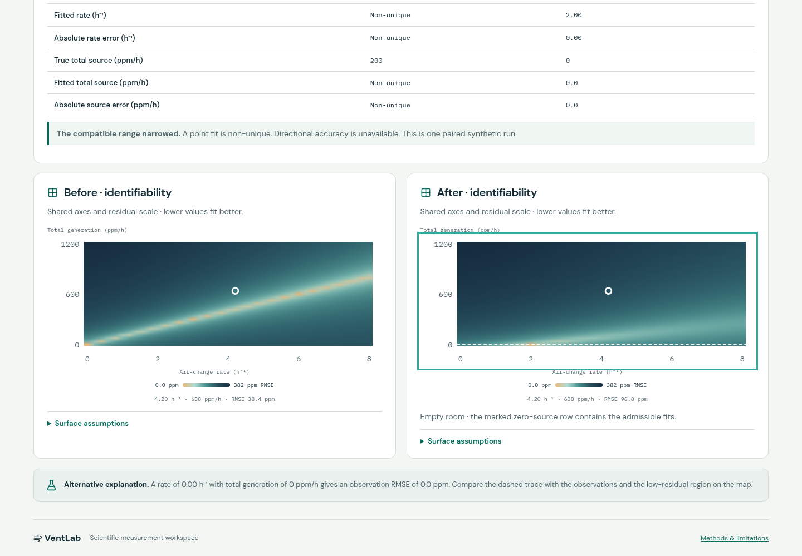

# VentLab

[Open the public application](https://giandegruccio.github.io/ventlab/)

An indoor CO₂ sensor can give the same reading in two rooms with different ventilation rates. VentLab shows which rates the measurements support, why competing explanations fit and which repeat measurement could help distinguish them. All computation and CSV processing run locally in the browser.

## Try it in thirty seconds

1. In **Experiment designer**, start the guided demo. One occupant adds CO₂ as fast as ventilation removes it. The sensor stays at 520 ppm.
2. **Inspect the map** to see how different combinations of generation and ventilation can sustain that reading.
3. **Compare an empty room**. Removing the source lets the CO₂ decay. Compare the compatible ranges. The equilibrium admits many rates, so directional point accuracy is unavailable.



## Plan from a recording

Choose **Plan my next measurement** in Blind validation or Data explorer. Select a window from a bundled recording or import a local CSV. Review its measured starting level, timing, occupancy and supply availability, enter an assumed sensor noise level and set practical constraints. The robust planner ranks feasible repeat measurements across plausible room conditions. The recording report preserves estimator flags and abstentions. A separate synthetic report can compare estimated and known parameters.

[Recording and report guide](docs/recording-to-plan.md) · [Recording workflow screenshot](docs/screenshots/rc1/recording-window-1440.png) · [Interactive evidence on mobile](docs/screenshots/rc1/evidence-390.png)

## What the evidence supports

The independent synthetic study paired four decision policies across eight fixed stress cases and three predeclared blocks of 32 seeds per case. MAE measures absolute error in the fitted rate. “Inside” counts trials whose compatible regions included the time-average target.

| Policy | Rate MAE (h⁻¹) | Mean width (h⁻¹) | Mean minutes | Inside |
|---|---:|---:|---:|---:|
| Keep the measurement | 1.471 | 3.773 | 40.25 | 447/768 |
| Matched nominal | 1.314 | 2.883 | 45.50 | 370/768 |
| Simple feasible rule | 1.209 | 2.809 | 60.00 | 353/768 |
| Robust ensemble | 1.198 | 2.832 | 45.25 | 356/768 |

In the RC1 synthetic study, robust planning narrowed the span and increased rate error in **154/768** trials. All 96 robust spans missed the time-average target when source and fan drifted together. The intervals have no calibrated coverage probability. Robust and nominal planning use the same actions, keep-current option and time penalty. The separate occupancy-responsive control demonstrates that emptying a room can change the target itself. [RC1 results and reproduction](docs/phase6-review.md) · [Historical Phase 3 evidence](docs/stress-protocol.md)

In the previously inspected **retrospective** evaluation file, 12 of 21 periods yielded a decay fit. Ten had a usable mechanical comparison. Mean absolute discrepancy was **0.72 h⁻¹**, and the mechanical rate fell within the sensitivity range in **4/10** comparisons. Air exchanged in a room can differ from mechanical supply. No prospective building study has established field accuracy or recommendation effectiveness. [Measured findings](reports/findings.md)

## Architecture and attribution

React and TypeScript provide the interface. A browser worker evaluates the robust design objective. Vite builds relative static assets for GitHub Pages. Python supplies the offline reference simulation and archived retrospective evaluation. Shared fixtures check Python–TypeScript numerical agreement. [Numerical parity](docs/parity.md) · [Ensemble model](docs/robust-planning.md)

The bundled data are *Indoor occupancy ground truth dataset with variable ventilation*, v1.0, by Julius Mikala, Yinda Xu and Matti Huotari (2026), CC BY 4.0. The original CSVs are preserved. The project's MIT software license is separate. [Dataset and metadata](https://doi.org/10.5281/zenodo.18299691) · [Rights and attribution](NOTICE.md)

**AI use.** OpenAI Codex assisted with implementation, documentation and test authoring. The reported numbers come from the versioned numerical programs and evidence files. Reviewers can reproduce the outputs independently.

## Run locally

With Node.js 24 and npm installed, run the following from the repository root.

```sh
cd web
npm ci
npm test
npm run build
npm run dev
```

Open the URL printed by Vite. For a static distribution, run `npm run build` in `web/` and serve `web/dist/`. The application uses hash navigation and relative asset URLs for GitHub Pages project paths.

- [Application guide, deployment and verification](docs/web-application.md)
- [Experiment design model, strategy ranking and seeded benchmark](docs/design-study.md)
- [Python–TypeScript numerical agreement](docs/parity.md)
- Phase 2 screenshots: [Desktop](docs/screenshots/designer-1440.png) · [Mobile](docs/screenshots/designer-390.png) · [Identifiability and strategy ranking](docs/screenshots/measurement-design.png) · [Blind validation](docs/screenshots/validation-1440.png)

## Phase 1 scientific reference

Phase 1 estimates a constant effective air-change rate from one room's CO₂ record and reports when the data give little support for that estimate. The default run is offline. See [the computed findings](reports/findings.md) and [the scientific protocol](docs/science.md).

## Reproduce

Use Python 3.12.14. Run the following from this directory. A clean environment needs internet access once to install the pinned scientific packages.

```sh
python -m venv .venv
. .venv/bin/activate
python -m pip install -r requirements.txt
python -m unittest discover -s tests -v
python -m ventlab.run --out reports/phase6/empirical
```

The empirical command verifies the size and MD5 of each CSV against the saved Zenodo record, writes SHA-256 digests to the audit and recomputes the retrospective results. Pass `--data DIR` to select a data directory containing `raw/` and `zenodo-record.json`. Pass `--out DIR` to write a fresh comparison run. There is no random component to inference, windowing, or scoring. The synthetic reference-blindness test uses a fixed seed.

## Files

| Path | Purpose |
|---|---|
| `data/raw/*.csv` | Unchanged source CSV byte streams |
| `data/zenodo-record.json` | Publisher metadata, attribution, license, file sizes and checksums |
| `ventlab/protocol.py` | Field names, units and declared physical and analysis constants |
| `ventlab/data.py`, `audit.py` | Integrity, source-order sessions, occupancy periods and sensor audit |
| `ventlab/physics.py` | Simulation, conditional constant-rate fit and log-linear baseline |
| `ventlab/inference.py` | Reference-blind windows, abstention, sensitivity scenarios and diagnostic flags |
| `ventlab/evaluation.py`, `report.py`, `run.py` | Reference handling, metrics, report rendering and offline entry point |
| `tests/` | Automated numerical, diagnostic, audit and leakage regression tests |
| `reports/audit.json` | Columns, units, ranges, sampling intervals, anomalies and individual session bounds |
| `reports/predictions.json` | Predictions, scenario fits and failures before airflow joins |
| `reports/windows.csv` | Every occupancy period, status, diagnostics, baseline and mechanical comparison |
| `reports/metrics.json`, `findings.md` | File, session, duration, signal and diagnostic-group performance |
| `reports/test-results.txt` | Captured automated test run |
| `docs/science.md`, `NOTICE.md` | Scientific interpretation, data provenance and separate licensing information |

The audit's data-row numbers start at 1 after the CSV header. Prediction and scoring row indices start at 0. Empty numeric fields in the ledger and JSON nulls denote unavailable comparisons. A fitted zero is a numeric result at the lower search boundary. All air-change rates and absolute errors use h⁻¹.

## Review status

The original Phase 1 analysis workspace had no root CSVs or repository checkout. The three CSVs from this repository matched the archived originals byte-for-byte at integration. The Phase 1 tree was created in the shared workspace using the exact bytes from the specified Zenodo version. The source record, code, tests and reports travel together in the review archive. This retrospective analysis cannot establish generalization to another room or a previously unseen collection.
